# ARNGREN — redesign com a técnica SCAMPER

Protótipo navegável de um redesign do site [arngren.net](https://arngren.net), uma loja norueguesa de eletrônicos, hobby e veículos elétricos famosa pelo visual caótico. O projeto aplica a técnica criativa **SCAMPER** para resolver os problemas de usabilidade do site **sem perder a identidade “anos 2000”** que o tornou conhecido.

**🔗 [Ver o protótipo no ar](https://arngren-scamper-prototipo.vercel.app)**

> ⚠️ **Projeto acadêmico, sem fins comerciais e sem ligação com a Arngren.** O nome, o logotipo e as fotos dos produtos pertencem aos seus donos e aparecem aqui apenas como objeto de estudo. Preços, avaliações, eventos e posts do fórum são fictícios; nenhuma compra, mensagem ou cadastro é real.

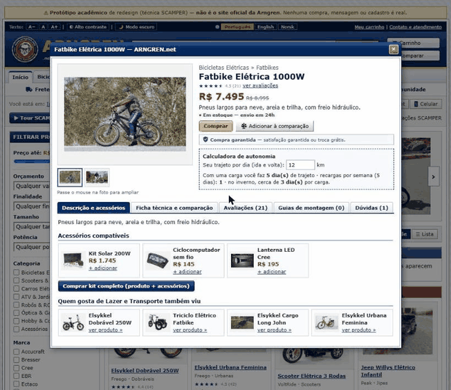

---

## Sumário

- [O problema](#o-problema)
- [Processo: técnica SCAMPER](#processo-técnica-scamper)
- [Antes × depois](#antes--depois)
- [Principais telas](#principais-telas)
- [Decisões de design](#decisões-de-design)
- [Tecnologias e estrutura](#tecnologias-e-estrutura)
- [Como rodar localmente](#como-rodar-localmente)
- [Limitações do protótipo](#limitações-do-protótipo)
- [Como o projeto foi feito](#como-o-projeto-foi-feito)
- [Créditos](#créditos)

---

## O problema

O site original concentra centenas de produtos em uma única página, montada com tabelas e imagens de tamanhos diferentes. Na análise, os principais problemas foram:

- **Poluição visual**: imagens sobrepostas, fontes e cores misturadas, banners soltos e textos em várias cores.
- **Sem hierarquia de navegação**: categorias espalhadas pela tela, sem menu claro nem destaque para a seção atual.
- **Busca escondida**: um campo pequeno no meio da página, sem filtros nem sugestões.
- **Preços que parecem links**: valores em vermelho e sublinhados, sem botão de compra separado.
- **Contato espalhado**: telefone, fax, Skype e vários e-mails em pontos diferentes do site.
- **Código legado**: estrutura em tabelas, pouco acessível e sem adaptação para celular.

---

## Processo: técnica SCAMPER

Cada letra do SCAMPER gerou um conjunto de melhorias. No protótipo, a opção **“Mostrar anotações SCAMPER”** marca na tela a letra de cada parte, e o botão **“▶ Tour SCAMPER”** apresenta as melhorias passo a passo.

| Letra | Pergunta | O que foi feito no protótipo |
|---|---|---|
| **S — Substituir** | O que pode ser trocado por algo melhor? | Selo de garantia discreto; preço com estilo próprio e botão “Comprar” separado; busca grande e fixa com lupa e autocompletar; página de contato organizada; menu único de categorias; cards padronizados; HTML semântico; paleta com contraste WCAG AA; novo logo. |
| **C — Combinar** | O que pode ser unido? | Busca dentro de uma categoria; acessórios compatíveis na página de cada veículo; destaque para produtos multifuncionais; comparação lado a lado; recomendações por interesse; avaliações de clientes; faixa de vantagens. |
| **A — Adaptar** | O que pode ser adaptado de outros contextos? | Navegação de grandes lojas virtuais; layout para celular, tablet e computador; grade ou lista; assistente virtual; recomendações pelo histórico; vitrines horizontais estilo streaming; comparação automática de preços; filtros por orçamento, finalidade, tamanho e potência; galeria com zoom; barra de compra fixa; modo escuro; **três idiomas (PT, EN, NO) com preços na moeda local**. |
| **M — Modificar** | O que pode ser ampliado, reduzido ou ajustado? | Layout com respiro e menos densidade; busca ampliada com filtros; imagens em molduras iguais (4:3, fundo neutro); tipografia e paleta unificadas; contagem regressiva nas ofertas. |
| **P — Propor outro uso** | Em que outros contextos o site pode servir? | Portal da comunidade com guias de montagem passo a passo, fórum de suporte, projetos dos membros e mapa de eventos; catálogo digital em formato de revista e **vitrine 3D** para colecionadores; calculadora de autonomia dos veículos elétricos. |
| **E — Eliminar** | O que pode ser removido? | Banners piscantes e fontes neon; estrutura em tabelas; checkout longo, substituído por uma única tela sem cadastro obrigatório. |
| **R — Reorganizar** | O que pode mudar de ordem ou estrutura? | Menu de categorias e subcategorias; página inicial em seções (Mais vendidos, Lançamentos, Ofertas da semana); cards na ordem imagem → título → preço → comprar; página de produto em abas; banner rotativo. |

A lista completa de itens, com as justificativas, está em [`docs/scamper-novos-itens.md`](docs/scamper-novos-itens.md).

---

## Antes × depois

**Antes**: página inicial do site original (captura de uma cópia arquivada no [Internet Archive](https://web.archive.org/web/2025/https://arngren.net/)).

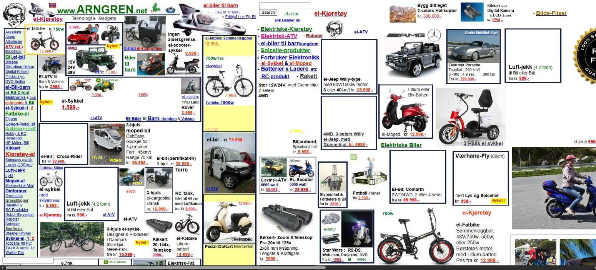

**Depois**: página inicial do protótipo.

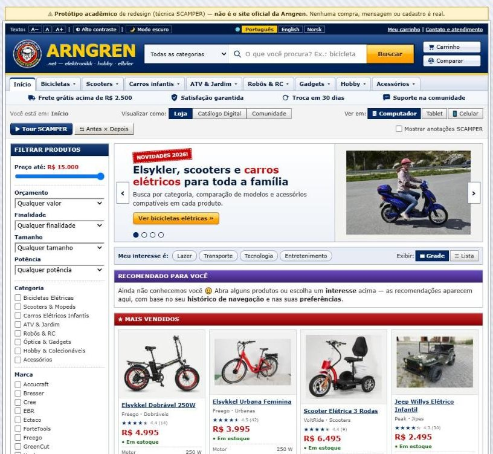

O próprio protótipo tem o botão **“⇆ Antes × Depois”**, que coloca o site original e o redesign lado a lado com uma divisória arrastável (o lado “antes” depende de o arngren.net estar no ar).

---

## Principais telas

| Página de produto | Avaliações |
|---|---|
| 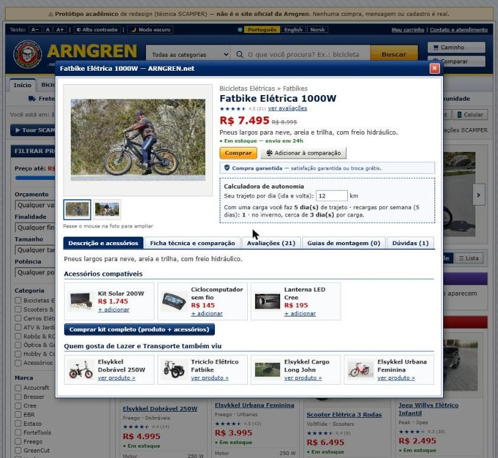 | 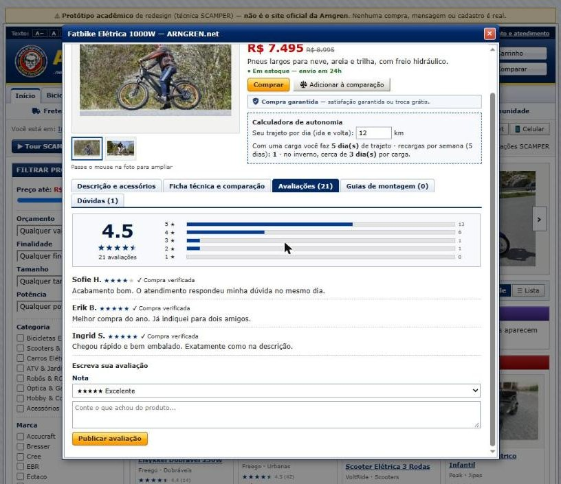 |
| Galeria com zoom, preço com botão separado, selo de garantia discreto, calculadora de autonomia, acessórios compatíveis e conteúdo organizado em abas. | Nota média, distribuição das notas e formulário para o cliente avaliar. |

| Checkout em um passo | Assistente virtual |
|---|---|
| 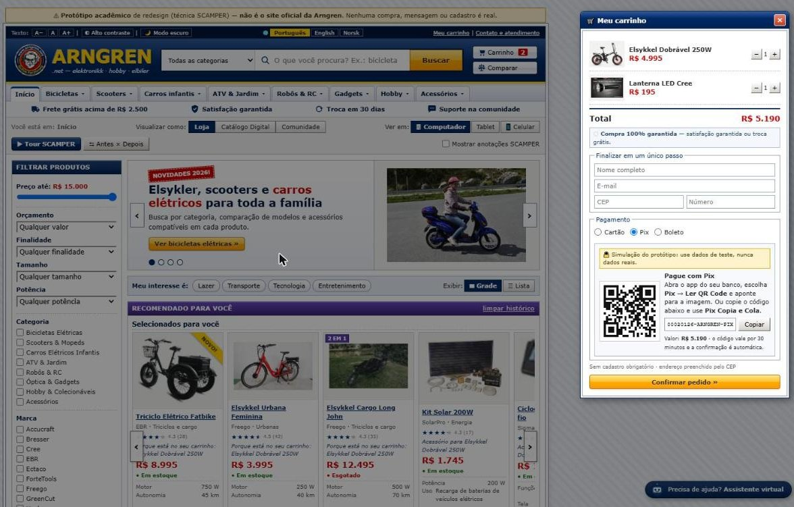 | 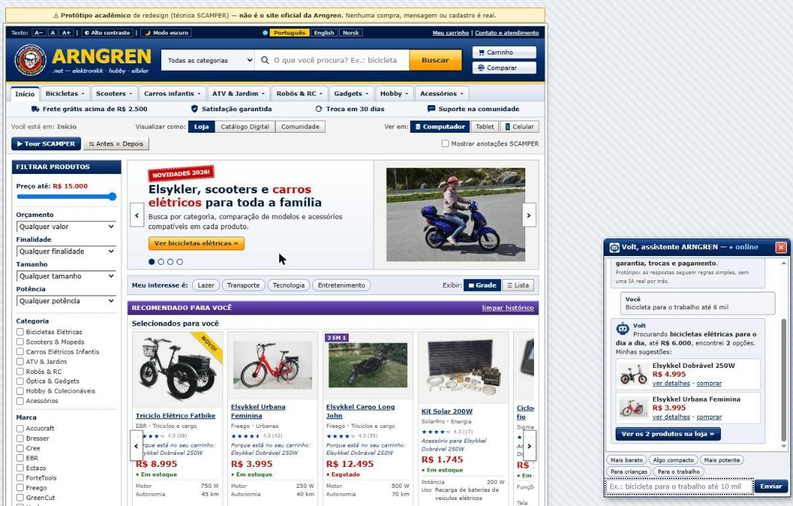 |
| Sem cadastro obrigatório: dados, endereço e pagamento (cartão com parcelas, Pix com QR Code ou boleto) na mesma tela. Pagamento simulado. | O “Volt” entende pedidos como *“bicicleta para o trabalho até 6 mil”* e sugere produtos pela finalidade, orçamento, tamanho e potência. |

| Comunidade | Vitrine 3D para colecionadores |
|---|---|
| 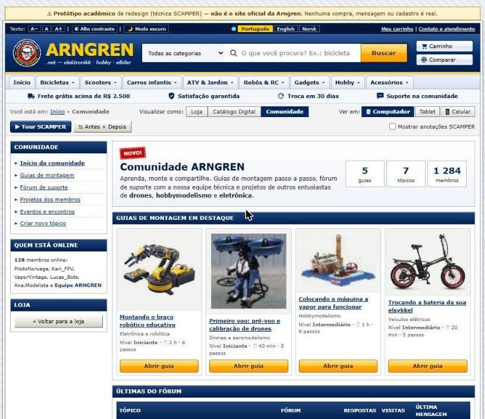 | 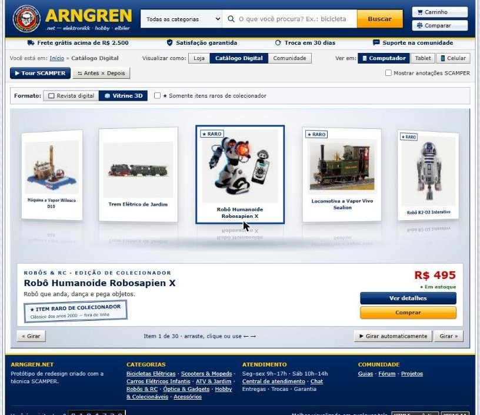 |
| Guias de montagem passo a passo, fórum de suporte no estilo dos fóruns dos anos 2000, projetos e eventos. | Carrossel 3D giratório com filtro para itens raros de colecionador. |

| Celular | Inglês (US$) | Norueguês (kr) |
|---|---|---|
| 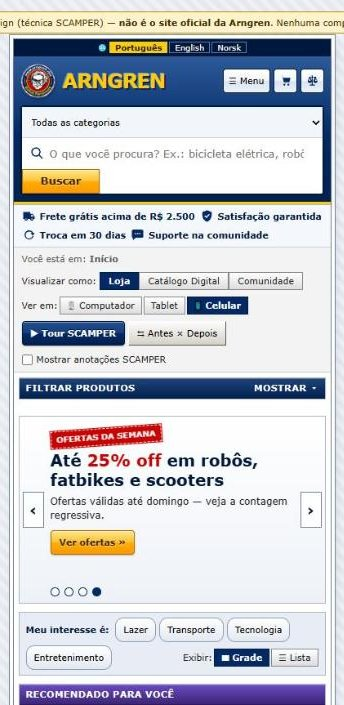 | 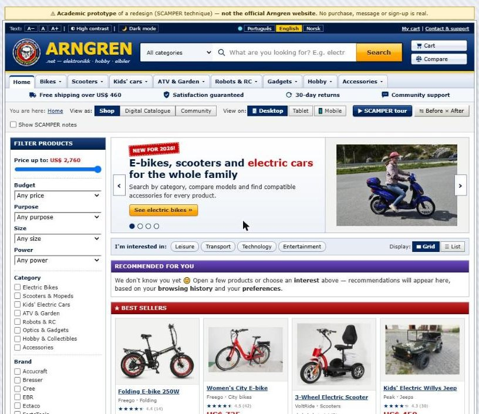 | 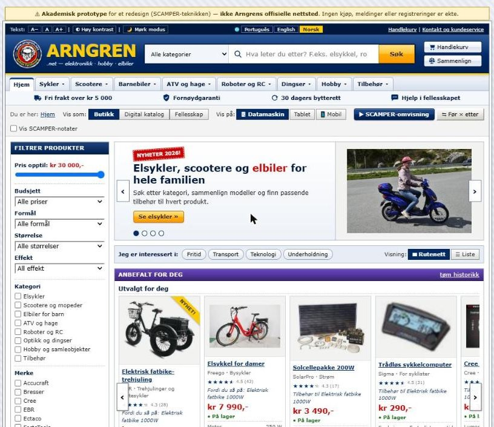 |
| O mesmo site se adapta ao celular e ao tablet. | Interface, catálogo e assistente traduzidos; preços em dólar. | Preços em coroas norueguesas, a moeda original do site. |

---

## Decisões de design

- **Manter a identidade dos anos 2000.** O charme do Arngren é o visual “retrô”; a proposta foi organizá-lo, não apagá-lo. Daí os botões com brilho, as caixas com títulos em degradê, o contador de visitantes e as janelas no estilo Windows XP.
- **Paleta azul com destaques pontuais.** Azul como base, com uma cor de destaque por seção (vermelho em Mais vendidos, laranja em Ofertas, roxo em Recomendações, verde na Comunidade) e laranja nos botões de compra.
- **Uma única tipografia** (Verdana) e **imagens padronizadas** em molduras 4:3 com fundo neutro.
- **Acessibilidade como requisito**: contraste mínimo de 4,5:1 (WCAG AA), HTML semântico, texto alternativo nas imagens, link “pular para o conteúdo”, botões A−/A+, alto contraste e navegação por teclado.
- **Sem frameworks.** HTML, CSS e JavaScript puros, para manter o protótipo leve e fácil de publicar.

---

## Tecnologias e estrutura

- HTML5 semântico, CSS3 (Grid, Flexbox, **container queries**, transformações 3D) e JavaScript puro (sem bibliotecas).
- Publicado na [Vercel](https://vercel.com) a partir deste repositório.
- Preferências do visitante (idioma, histórico, avaliações, posts) ficam no `localStorage` do navegador.

```
├── index.html          estrutura da página
├── css/
│   └── style.css       todos os estilos (com as anotações de cada letra do SCAMPER)
├── js/
│   ├── data.js         catálogo: produtos, categorias, fotos e moedas
│   ├── shop.js         loja: cards, busca, filtros e comparação
│   ├── cart.js         carrinho e checkout (cartão, Pix e boleto simulados)
│   ├── catalog.js      revista digital e vitrine 3D
│   ├── community.js    guias de montagem, fórum, projetos e eventos
│   ├── adapt.js        responsivo, histórico, recomendações e vitrines
│   ├── assistant.js    assistente virtual Volt
│   ├── substitute.js   busca com autocompletar, menu e página de contato
│   ├── design.js       avaliações, página de produto, banner, acessibilidade, tour e antes/depois
│   ├── i18n.js         idiomas (PT, EN, NO) e preços na moeda local
│   └── main.js         inicialização
├── img/                logotipo
└── docs/               documento SCAMPER e imagens deste README
```

---

## Como rodar localmente

Não há instalação nem etapa de build. Basta servir a pasta:

```bash
python -m http.server 5173
```

Depois abra `http://localhost:5173`. Também funciona abrindo o `index.html` direto no navegador (só o “Antes × Depois” precisa de servidor).

---

## Limitações do protótipo

- **Assistente virtual**: segue regras simples de palavras-chave; não há uma IA real por trás.
- **Câmbio fixo**: os preços partem das coroas norueguesas e são convertidos com taxas fixas de referência (1 kr ≈ R$ 0,50 ≈ US$ 0,092). Em produção, viriam de um serviço de câmbio.
- **Fotos dos produtos**: carregadas do arngren.net; quando o site está fora do ar, o protótipo usa as cópias do Internet Archive e, em último caso, uma imagem substituta.
- **Pagamentos**: totalmente simulados; nenhum dado é guardado ou enviado. Para testar o cartão, use `4111 1111 1111 1111`.
- **Dados fictícios**: preços, avaliações, eventos, posts do fórum, telefone e e-mail de contato são exemplos.

---

## Como o projeto foi feito

A análise SCAMPER foi feita em grupo, como atividade acadêmica. A partir dela, o protótipo foi desenvolvido **com auxílio de IA** (Claude, da Anthropic): a direção, as decisões de design e de conteúdo, a revisão e os testes foram meus; boa parte do código foi gerada pela IA a partir dessas orientações.

---

## Créditos

- **Análise SCAMPER (grupo):** _[nomes dos integrantes]_
- **Disciplina / instituição:** _[preencher]_
- **Protótipo:** Jamile Keiller
- **Site original, marca e fotos dos produtos:** [Arngren](https://arngren.net), usados apenas como objeto de estudo.
- **Mapa dos eventos:** © [OpenStreetMap](https://www.openstreetmap.org/copyright).
- **Cópias arquivadas das fotos e do site original:** [Internet Archive](https://archive.org).
